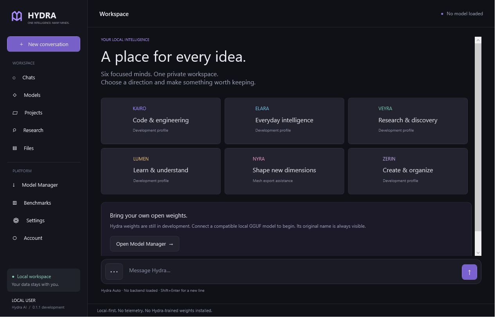

# HYDRA AI

**One Intelligence. Many Minds.**

A free, open-source, local-first AI platform for Windows. Version 0.1.1 includes local chat, specialist profiles, file exports and backups. It runs third-party GGUF models; independently trained Hydra weights remain in development.

## Hydra models

| Profile | Purpose | Weight status |
| --- | --- | --- |
| Kairo | Coding and software engineering | Developmental |
| Elara | General assistance | Developmental |
| Veyra | Research and source synthesis | Developmental |
| Lumen | Tutoring and study | Developmental |
| Nyra | 3D research | Developmental; mesh export assistance |
| Zerin | Creative work and planning | Developmental |

Hydra Auto uses transparent keyword rules, not a trained router. Text profiles can use explicitly named third-party GGUF development backends. They are never presented as Hydra weights. Nyra can help produce mesh specifications for local export. Independently trained native 3D generation remains planned.

## Installation

Use `HydraAI-Setup.exe` when provided with a release, or extract the portable build and open `HydraAI.exe`. Continue locally without an account. No developer tools are required for a runtime-bundled build.

The packaged development release includes **SmolLM2-135M-Instruct (bartowski Q4_K_M)** and llama.cpp as a clearly labelled starter backend. In **Model Manager**, click **Set up starter backend**, then **Load locally**. Start a new conversation. This small third-party model has limited quality and is not Hydra-trained intelligence. Setup runs offline.

For other models, choose a trusted `llama-server.exe`, then import a GGUF file, recording its original model name and license. Only use weights where their license permits it. Source-only builds contain no model weights or native inference engine; see [local inference](docs/LOCAL_INFERENCE.md).

## Composer, backups and downloadable files

Type in the compact message bar. **Enter** sends; **Shift+Enter** adds a line. Open **⋯** for profiles, the backend Model Manager, attachments and conversation actions.

In **Settings → Backups · Obsidian & Git**, connect an existing local Obsidian vault or Git repository. Enable automatic backups for saved outputs and approved workspace edits, or use **Files → Back up now**. Snapshots go into `HydraAI-Backups` within each destination. Optional local Git commits require `git.exe`; Hydra never pushes to a remote. Your existing sync tools may upload the destination folders. Existing notes and unrelated staged Git changes are preserved.

Response code blocks have **Save** buttons. Saved files remain in **Files**, even if you cancel the external Save dialog. HTML and source files save directly. Roblox scripts can become `.rbxlx` places without extra tools; binary `.rbxl` uses Rojo. Validated `hydra-mesh` JSON exports directly to `.obj`, or through Blender to `.blend`/`.fbx`. C# can be compiled into a ZIP containing a real Windows EXE and its companion files using the .NET 10 SDK; the destination PC needs .NET 10. C++ currently saves as source. Set tool paths in **Settings → File export tools**. These tools are optional and are not bundled.

See [file export details and examples](docs/FILE_EXPORTS.md). Binary output requires a successful compiler/exporter; changing an extension cannot create a valid binary file. The small starter model may produce invalid source or mesh data, which the compiler/exporter will reject.

## Implemented, experimental, planned

- **Available:** native desktop navigation; SQLite conversations/settings; six specialist profiles; deterministic Auto routing; model registration/hash verification; local streaming adapter; cancellation; text attachments and retrieval; constrained workspace read/write with undo; CPU/RAM detection; privacy controls; research interfaces; Python dataset/evaluation utilities.
- **Experimental:** local inference compatibility across llama.cpp versions; local workspace tools; small-model training code. These need broader real-model/security testing.
- **Planned:** independently trained Hydra weights; cloud accounts/sync; autonomous command execution; native 3D generation; image/PDF/Office understanding; GPU auto-configuration; full research browsing; production signed updates; MoE/RL pipelines.

## Hardware requirements

Windows 10/11 x64. The launcher is lightweight; inference requirements depend on weights, quantization, context, and runtime. A small quantized model may fit in 8 GB system RAM; larger models require substantially more. Hardware recommendations are rough capacity guidance, not validated guarantees. No GPU is required for a compatible CPU runtime.

## Building from source

Install the .NET 10 SDK. Run `scripts/build.ps1`, then `scripts/test.ps1`. `scripts/package.ps1` publishes a self-contained Windows build and can invoke Inno Setup 6 if installed. Python 3.11+ runs the standard-library dataset/evaluation tests. PyTorch is optional and only needed for training experiments.

## Model development

See [hydra-ml](hydra-ml/README.md). Training examples use explicit licensed input manifests, deterministic splits, provenance, hash-based deduplication, PII heuristics and evaluation contamination checks. No private chat data enters the training pipeline. The tiny transformer is a learning/reproducibility baseline, not a Hydra production model.

## Privacy

No telemetry, advertisements, quotas, paid tiers, automatic uploads or hidden analytics. Conversations remain on this machine. Research/download networking is opt-in. Local files are not encrypted by Hydra; use OS disk encryption if needed. See [PRIVACY.md](PRIVACY.md).

## Screenshots

Screenshot of the Windows desktop application.

## Roadmap and contributing

[Architecture](ARCHITECTURE.md) · [Roadmap](ROADMAP.md) · [Contributing](CONTRIBUTING.md) · [Security](SECURITY.md). Submit measured, reproducible improvements; never fabricate benchmark results or model provenance.

## Licensing

Original code is MIT licensed. Models, datasets, inference engines and runtimes retain their own licenses. See [THIRD_PARTY.md](THIRD_PARTY.md). There is no OpenAI, Anthropic, Gemini or other proprietary intelligence API dependency.
